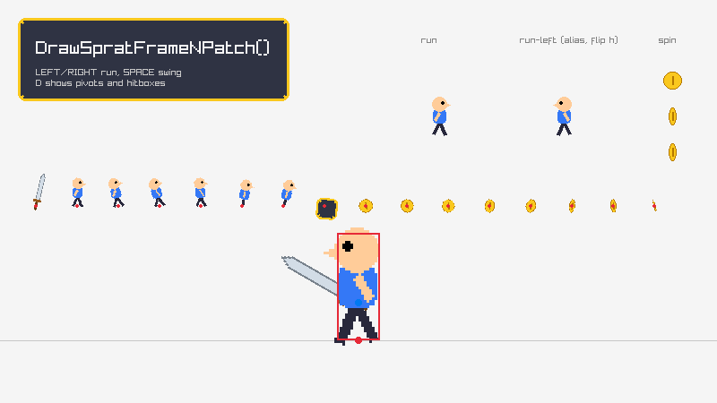

# sprat-raylib

Load and draw [sprat-cli](https://github.com/pedroac/sprat-cli) sprite sheets with
[raylib](https://www.raylib.com/).

A single-file C99 library in the style of raylib's own extras (`raygui.h`,
`rres-raylib.h`): plain structs, `Load`/`Unload`/`Is…Valid`/`Draw` functions, and
`TraceLog()` for problems. It reads the metadata written by
`spratconvert --transform raw` through [sprat-lib](https://github.com/pedroac/sprat-lib),
loads the atlas textures next to it, and draws sprites the way they were
authored: placed by their pivot, with trimming and packing rotation undone.



```sh
spratlayout ./frames --trim-transparent --rotate > layout.txt
spratpack -a atlas.png < layout.txt > /dev/null
spratconvert --transform raw -a atlas.png \
    --markers markers.txt --animations animations.txt < layout.txt > hero.sprat
```

```c
#include "raylib.h"

#define SPRAT_RAYLIB_IMPLEMENTATION
#include "sprat-raylib.h"

int main(void)
{
    InitWindow(800, 450, "sprat-raylib");

    SpratSheet sheet = LoadSpratSheet("resources/hero.sprat");
    SpratAnimationPlayer run = MakeSpratAnimationPlayer(GetSpratAnimation(sheet, "run"));

    while (!WindowShouldClose())
    {
        UpdateSpratAnimation(&run, GetFrameTime());

        BeginDrawing();
            ClearBackground(RAYWHITE);
            DrawSpratAnimation(sheet, run, (Vector2){ 400, 300 }, WHITE);
        EndDrawing();
    }

    UnloadSpratSheet(sheet);
    CloseWindow();
    return 0;
}
```

## Building

`src/sprat-raylib.h` is the whole library. Define `SPRAT_RAYLIB_IMPLEMENTATION` in
exactly one C file before including it, and link raylib (5.5 or newer) and
sprat-lib (0.15 or newer):

```sh
cc game.c -Isrc -I../sprat-lib/include ../sprat-lib/src/*.c -lraylib -lm
```

With CMake, link `sprat-raylib::sprat-raylib`, which compiles the implementation
and brings raylib along:

```cmake
add_subdirectory(sprat-raylib)          # or find_package(sprat-raylib) after an install
target_link_libraries(game PRIVATE sprat-raylib::sprat-raylib)
```

## Documentation

The [guide](docs/guide.md) covers the build options, the full API, and how sheets,
sprites, animations, puppets, markers and nine-slices work.

## Example

[`examples/sprite_sheet.c`](examples/sprite_sheet.c) draws every frame of the
example sheet (most of them stored turned in the atlas), plays the `run`,
`run-left`, `spin` and `spin-pingpong` animations, resizes a nine-patch panel,
and lets you run a hero holding a sword at its `hand` marker, picking up
spinning coins its hitbox or the sword's `blade` touches. `D` shows pivots,
hitboxes and the blade.

The sheet in `examples/resources/` was packed with sprat-cli by
`make_resources.sh`, from frames drawn by `make_sources.py`.

## License

MIT. See [LICENSE](LICENSE).
