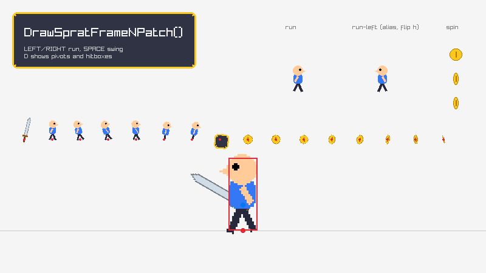

# sprat-raylib

Load and draw [sprat-cli](https://github.com/pedroac/sprat-cli) sprite sheets with
[raylib](https://www.raylib.com/).

A single-file C99 library in the style of raylib's own extras (`raygui.h`,
`rres-raylib.h`): plain structs, `Load`/`Unload`/`Is…Valid`/`Draw` functions, and
`TraceLog()` for problems. It reads the metadata written by
`spratconvert --transform raw` through [sprat-lib](https://github.com/pedroac/sprat-lib),
loads the atlas textures next to it, and draws sprites the way they were
authored: placed by their pivot, with trimming and packing rotation undone.



```sh
spratlayout ./frames --trim-transparent --rotate > layout.txt
spratpack -a atlas.png < layout.txt > /dev/null
spratconvert --transform raw -a atlas.png \
    --markers markers.txt --animations animations.txt < layout.txt > hero.sprat
```

```c
#include "raylib.h"

#define SPRAT_RAYLIB_IMPLEMENTATION
#include "sprat-raylib.h"

int main(void)
{
    InitWindow(800, 450, "sprat-raylib");

    SpratSheet sheet = LoadSpratSheet("resources/hero.sprat");
    int run = GetSpratAnimationIndex(sheet, "run");

    while (!WindowShouldClose())
    {
        BeginDrawing();
            ClearBackground(RAYWHITE);
            DrawSpratAnimation(sheet, run, (float)GetTime(), (Vector2){ 400, 300 }, WHITE);
        EndDrawing();
    }

    UnloadSpratSheet(sheet);
    CloseWindow();
    return 0;
}
```

## Building

`src/sprat-raylib.h` is the whole library. Define `SPRAT_RAYLIB_IMPLEMENTATION` in
exactly one C file before including it, and link raylib (5.5 or newer) and
sprat-lib (0.5 or newer):

```sh
cc game.c -Isrc -I../sprat-lib/include ../sprat-lib/src/*.c -lraylib -lm
```

With CMake, `sprat-raylib::sprat-raylib` (the `sprat-raylib` target) compiles the
implementation for you and brings raylib along:

```cmake
add_subdirectory(sprat-raylib)          # or find_package(sprat-raylib) after an install
target_link_libraries(game PRIVATE sprat-raylib::sprat-raylib)
```

```c
#include "sprat-raylib.h"               // no SPRAT_RAYLIB_IMPLEMENTATION: the library has it
```

The CMake build uses installed raylib and sprat packages when it finds them and
downloads them otherwise. To build against a local checkout, pass
`-DFETCHCONTENT_SOURCE_DIR_SPRAT=../sprat-lib` (or `FETCHCONTENT_SOURCE_DIR_RAYLIB`).

```sh
cmake -S . -B build -DBUILD_TESTING=ON
cmake --build build --parallel
ctest --test-dir build --output-on-failure
./build/examples/sprite_sheet
```

| Option | Default | Effect |
|---|---|---|
| `SPRAT_RAYLIB_BUILD_EXAMPLES` | `ON` when top level | Build `examples/sprite_sheet` |
| `SPRAT_RAYLIB_SANITIZE` | `OFF` | Build with AddressSanitizer and UBSan (GCC/Clang) |

## API

```c
// Sheet loading/unloading functions
SpratSheet LoadSpratSheet(const char *fileName);
SpratSheet LoadSpratSheetFromMemory(const unsigned char *fileData, int dataSize, const char *atlasDir);
bool IsSpratSheetValid(SpratSheet sheet);
void UnloadSpratSheet(SpratSheet sheet);

// Sheet query functions
int GetSpratFrameIndex(SpratSheet sheet, const char *pathOrName);
int GetSpratAnimationIndex(SpratSheet sheet, const char *name);
const SpratMarker *GetSpratFrameMarker(SpratSheet sheet, int frame, const char *name);
int GetSpratAnimationFrame(SpratSheet sheet, int animation, float time);
Vector2 GetSpratFramePoint(SpratSheet sheet, int frame, Vector2 point, Vector2 position, Vector2 scale, float rotation, int flip);

// Sheet drawing functions
void DrawSpratFrame(SpratSheet sheet, int frame, Vector2 position, Color tint);
void DrawSpratFrameEx(SpratSheet sheet, int frame, Vector2 position, float rotation, float scale, Color tint);
void DrawSpratFramePro(SpratSheet sheet, int frame, Vector2 position, Vector2 scale, float rotation, int flip, Color tint);
void DrawSpratFrameNPatch(SpratSheet sheet, int frame, Rectangle dest, Color tint);
void DrawSpratAnimation(SpratSheet sheet, int animation, float time, Vector2 position, Color tint);
```

### The sheet

`SpratSheet` is a plain struct, like raylib's `Model` or `Font`: pass it by
value, read its arrays directly, and unload it once.

```c
typedef struct SpratSheet {
    int atlasCount;             // Number of atlas textures
    Texture2D *atlases;         // Atlas textures
    int frameCount;             // Number of frames
    SpratFrame *frames;         // Frames, in sheet order
    int animationCount;         // Number of animations
    SpratAnimation *animations; // Animations, in sheet order
    float scale;                // Scale the art was packed at: draw at 1.0f/scale for its original size
} SpratSheet;
```

- **Frames** are the sheet's sprites, in its order. A `SpratFrame` keeps the
  atlas region as stored (`source`, `rotation`), the original image's `size`,
  the trimmed `content` region inside it, the `pivot`, the nine-slice insets
  (`slice`) and the frame's `markers`. Frame geometry is in original-image
  pixels, scaled to atlas pixels, with Y pointing down.
- **Animations** list frame indexes in play order, with an `fps` and the `flip`
  they are played with. Aliases are already resolved: `run-left`, an alias of
  `run` with `flip h`, has `run`'s frames (the same array, not a copy) and `flip` set to
  `SPRAT_FLIP_HORIZONTAL`. An animation may have no frames.
- **Names**: a frame's `name` is its file's basename and can repeat across
  folders; its `path` is unique. `GetSpratFrameIndex()` takes either: it
  matches the path first, then a name that only one frame has, and logs a
  warning and returns -1 otherwise. Look names up once, after loading, and
  keep the indexes.

Frames and animations keep the order of the sprat file, so the indexes that
sprat-lib's `sprat_sheet_bind()` resolves (and its animation frame indexes)
index `sheet.frames` and `sheet.animations` as they are.

### Drawing

Every draw function places a frame by its **pivot**, the point
`spratconvert` was given with a `pivot` marker (`0, 0`, the top-left of the
original image, when there was none). Trimmed margins are left out, and
frames that were packed turned are drawn upright.

`DrawSpratFramePro()` scales the frame, mirrors it about its pivot with
`SPRAT_FLIP_HORIZONTAL` and/or `SPRAT_FLIP_VERTICAL`, then turns it clockwise
around the pivot by `rotation` degrees, the same convention as
`DrawTexturePro()`. `DrawSpratFrame()` and `DrawSpratFrameEx()` are the
shorthands raylib users expect.

`scale` is yours to choose, and is not `sheet.scale`: frame geometry is in atlas
pixels, so `1.0f` draws atlas pixels one to one. For a sheet packed at
`--scale 0.5`, draw at `1.0f/sheet.scale` to show the art at its original
size.

### Animations

`GetSpratAnimationFrame()` gives the frame index shown after `time` seconds of
looped playback, and `DrawSpratAnimation()` draws it with the animation's
flip. They keep no state: keep a time per animated thing, and reset it to
restart. To draw an animation with your own transform, combine its flip with
yours:

```c
int frame = GetSpratAnimationFrame(sheet, run, enemy.time);
DrawSpratFramePro(sheet, frame, enemy.position, (Vector2){ 2, 2 }, 0.0f,
                  sheet.animations[run].flip ^ enemy.flip, WHITE);
```

### Markers

Markers (`pivot`, hitboxes, hands, spawn points...) are in original-image
pixels. `GetSpratFramePoint()` takes the same transform as `DrawSpratFramePro()`
and tells where a point of the original image lands on screen, for attaching
items or placing collision shapes:

```c
const SpratMarker *hand = GetSpratFrameMarker(sheet, frame, "hand");
if (hand != NULL)
{
    Vector2 grip = GetSpratFramePoint(sheet, frame, hand->position, hero, scale, 0.0f, flip);
    DrawSpratFramePro(sheet, sword, grip, scale, swordAngle, 0, WHITE);
}
```

A rectangle marker's `position` is its top-left corner; once mirrored, take
both corners through `GetSpratFramePoint()` and order them, as the example's
`DrawHitbox()` does.

### Nine-slices

`DrawSpratFrameNPatch()` draws a frame stretched to fill `dest`, keeping its
slice borders unscaled, like `DrawTextureNPatch()`. `dest` covers the whole
original image, trimmed margins included, and the pivot plays no part. It
cuts the slices in original-image space, so it handles trimmed frames and
frames packed turned, which `DrawTextureNPatch()` cannot. Borders shrink
proportionally when `dest` is smaller than them, and a frame without slice is
simply stretched.

Every fill mode is drawn as `SPRAT_SLICE_MODE_STRETCH`. `slice.horizontalMode`
and `slice.verticalMode` say which mode the artist chose, for code that tiles
the middle itself.

### Loading

`LoadSpratSheet()` reads the file with `LoadFileData()`, so it honors
`SetLoadFileDataCallback()`, and loads each atlas with `LoadTexture()`, joining
its path with the sheet's folder (absolute paths are used as written).
`LoadSpratSheetFromMemory()` takes the folder to resolve atlas paths against,
or `NULL` to use them as written.

Like raylib's loaders, these never return an error: problems go to
`TraceLog()`, with sprat-lib's message naming the value at fault and where it
is:

```
WARNING: SPRAT: [resources/hero.sprat] Failed to load sheet: 4:14: sprites[0].rect.w: expected an integer, found "4x"
```

A sheet that failed to parse is zeroed, and drawing with it draws nothing. A
missing atlas leaves its texture at `id` 0, so the frames on it are skipped.
`IsSpratSheetValid()` is true only when the metadata loaded and every atlas
texture is in the GPU. You can replace an atlas: unload `sheet.atlases[i]` and
assign another texture, and `UnloadSpratSheet()` will unload that one.

### Memory

The metadata is copied into one allocation (with `RL_CALLOC`, released with
`RL_FREE`), and sprat-lib's parsed sheet is freed before the loader returns.
Every array and string of a `SpratSheet` points into that allocation and stays
valid until `UnloadSpratSheet()`. `sheet.frames` is its start, so it is not
`NULL` after a successful load even when the sheet has no frames.

## Example

[`examples/sprite_sheet.c`](examples/sprite_sheet.c) draws every frame of the
example sheet (most of them stored turned in the atlas), plays the `run`,
`run-left` and `spin` animations, resizes a nine-patch panel, and lets you run
a hero holding a sword at its `hand` marker. `D` shows pivots and hitboxes.

The sheet in `examples/resources/` was packed with sprat-cli by
`make_resources.sh`, from frames drawn by `make_sources.py`.

## Limitations

- Normal and collision maps are not loaded. sprat-lib gives their paths if
  you need them.
- Atlas paths are used as written, so a sheet from an untrusted source could
  name any file. Parse such a sheet with sprat-lib first and check each
  `atlases[i].path` with `sprat_path_is_safe()` before loading it here.
- `GetSpratAnimationFrame()` takes a `float` time, which loses
  precision after hours: keep a time per animation rather than passing
  `GetTime()` for a long-running game.

## License

MIT. See [LICENSE](LICENSE).
